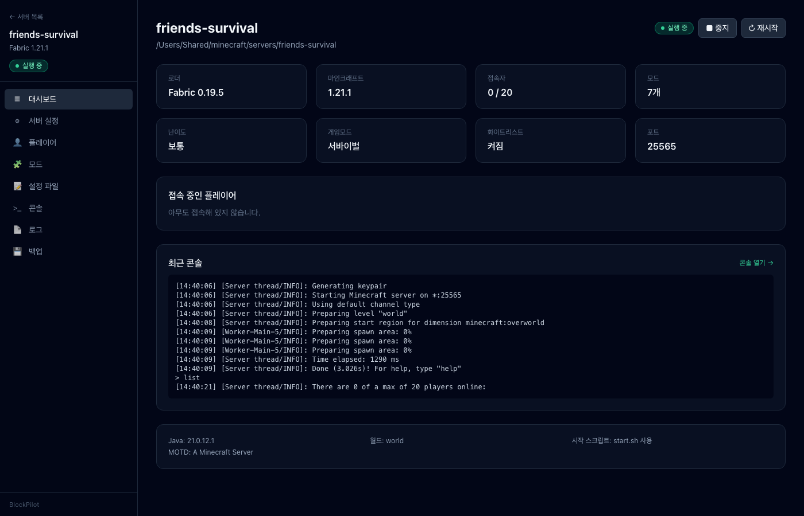
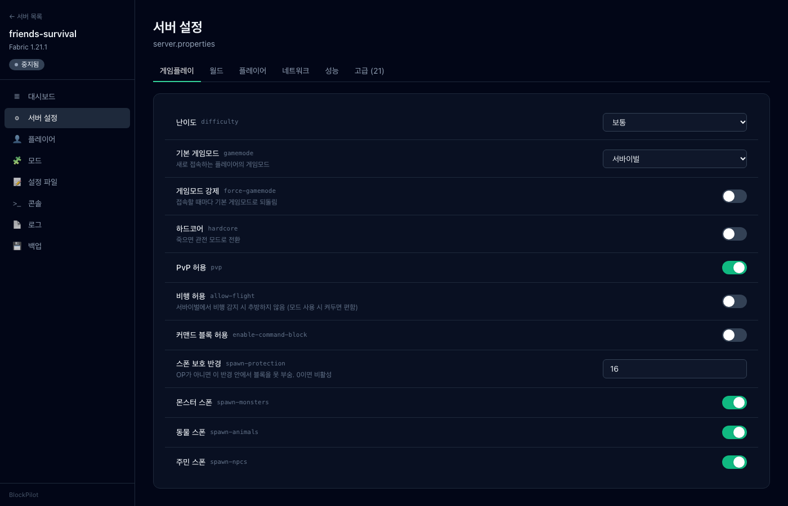
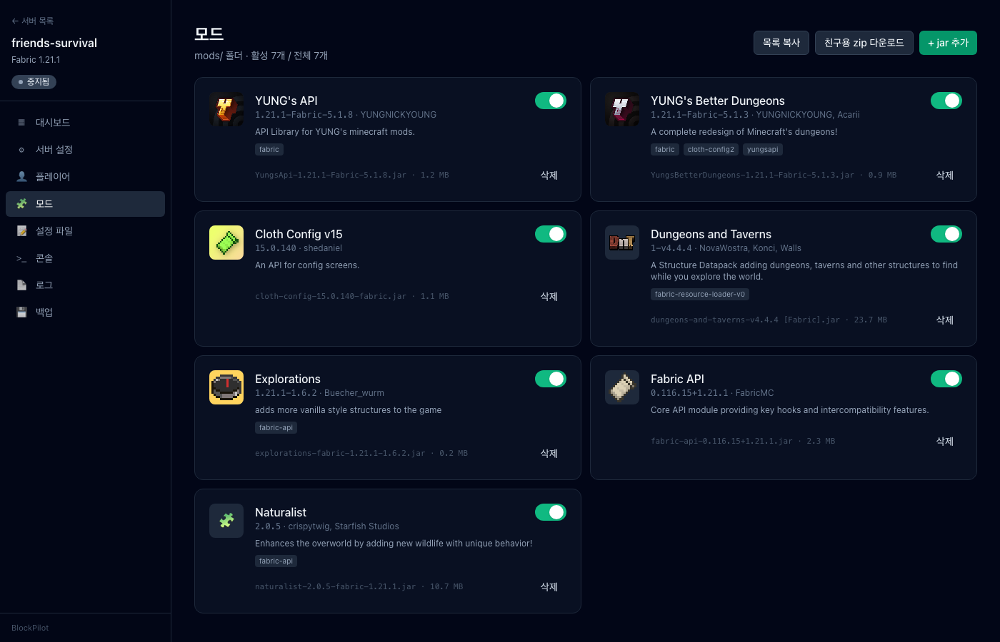
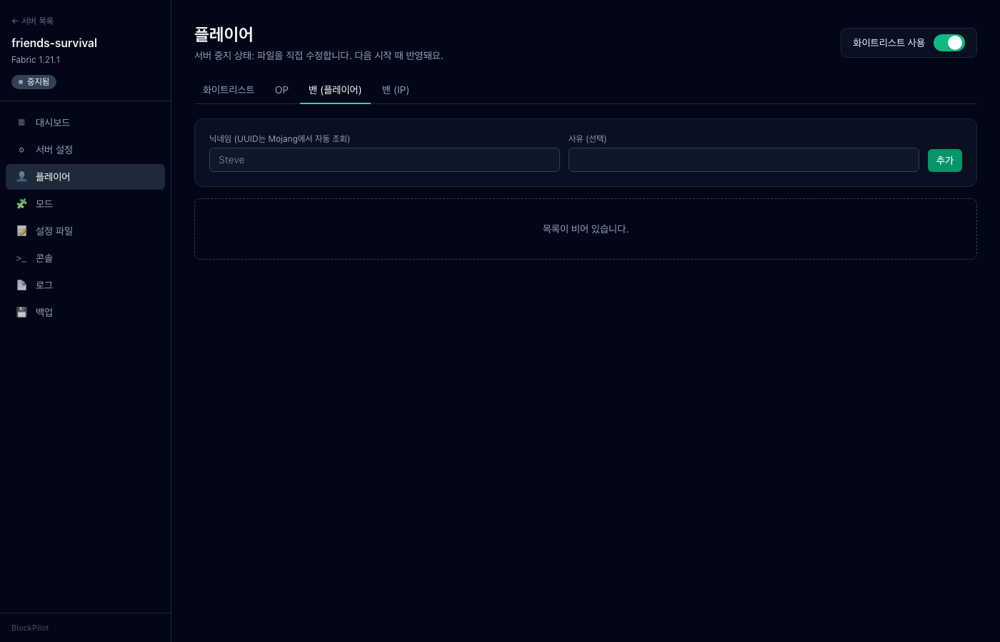
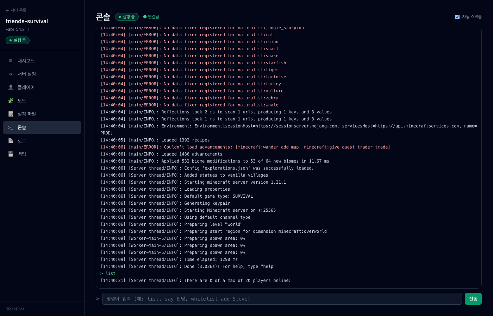
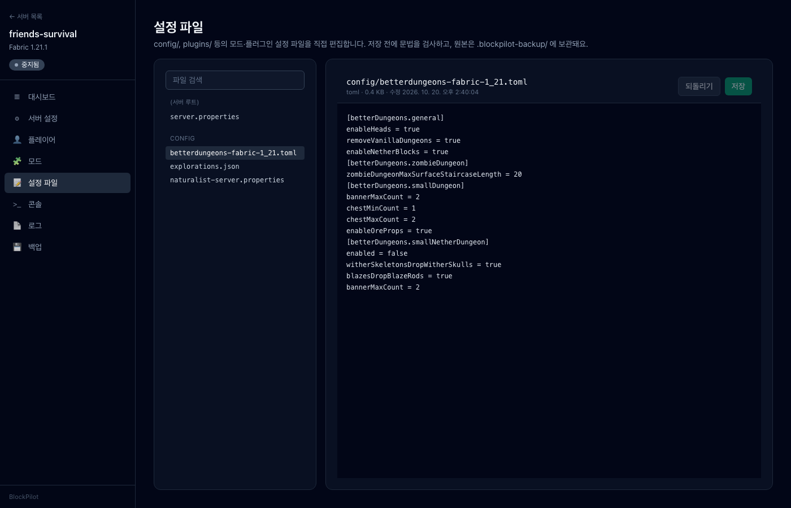
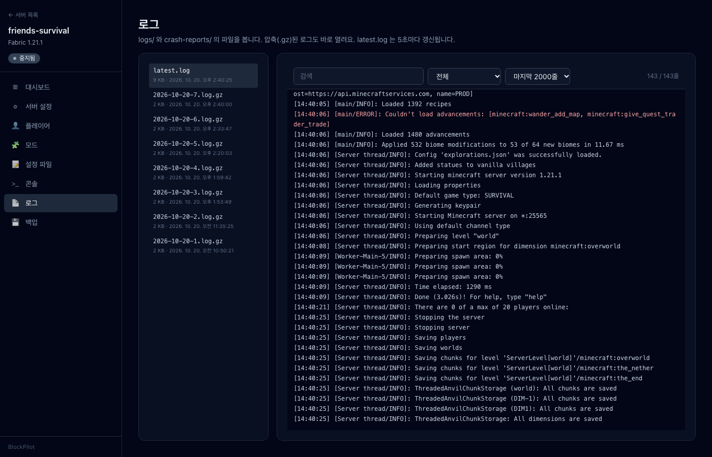
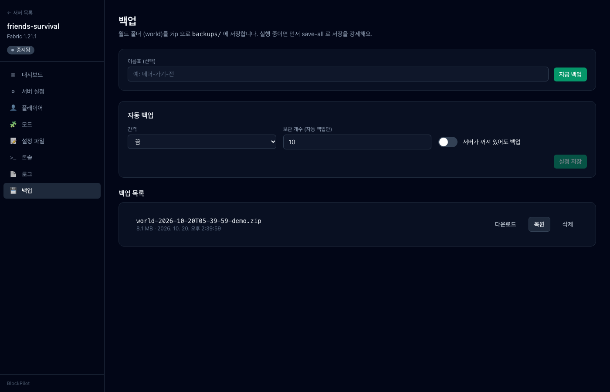

<p align="center">
  
</p>

<h1 align="center">BlockPilot</h1>

<p align="center">
  마인크래프트 서버 폴더 경로 하나만 등록하면<br>
  설정 · 모드 · 플레이어 · 콘솔 · 로그 · 백업을 브라우저에서 관리하는 로컬 대시보드
</p>

<p align="center">
  
  
  
  
  
  
</p>

---

## 왜 만들었나

친구들과 서바이벌 서버를 돌리다 보면 `server.properties` 열어서 난이도 고치고, `whitelist.json`에 UUID 찾아 넣고, 모드 버전 충돌 로그 뒤지는 일이 반복됩니다. BlockPilot은 그 작업을 전부 GUI로 옮기되, **서버가 이미 하고 있는 일을 망치지 않는 것**을 최우선으로 설계했습니다.

- 서버가 **실행 중이면** 콘솔 명령(`difficulty`, `whitelist add` …)으로 즉시 반영하고, 명령으로 못 바꾸는 항목은 파일에 저장한 뒤 "재시작 필요"로 표시합니다. (마인크래프트는 종료 시 설정 파일을 다시 쓰기 때문에, 실행 중에 파일을 직접 고치면 덮어써집니다.)
- 서버가 **중지 상태면** 파일을 직접 수정합니다. 쓰기 전에 `.blockpilot-backup/`에 사본을 남기고 임시 파일 → rename으로 원자적으로 교체합니다.
- BlockPilot **밖에서 띄운 서버**도 RCON이 켜져 있으면 명령·중지·접속자 조회가 됩니다.

## 기능

| | 화면 | 할 수 있는 것 |
|---|---|---|
| ▦ | **대시보드** | 로더·버전·접속자·모드 수 요약, 시작 / 중지 / 재시작, 접속자 킥·밴, 최근 콘솔 |
| ⚙ | **서버 설정** | `server.properties`를 게임플레이 / 월드 / 플레이어 / 네트워크 / 성능 탭의 폼으로 편집. 그 외 키는 고급 탭에서 raw 편집. 주석과 키 순서 보존 |
| 👤 | **플레이어** | 화이트리스트 · OP · 밴(플레이어/IP). 닉네임만 입력하면 Mojang API로 UUID 자동 조회 |
| 🧩 | **모드** | jar 안의 `fabric.mod.json` / `mods.toml` / `plugin.yml`을 읽어 이름·버전·설명·의존성 표시, **의존성 누락 경고**, 활성/비활성 토글, 삭제, 업로드, 친구용 클라이언트 모드 zip 내보내기 |
| 📝 | **설정 파일** | `config/`, `plugins/` 안의 toml · json · yaml · properties 편집기. 저장 전 문법 검사(오류 행 표시), `Cmd/Ctrl+S` 저장 |
| >_ | **콘솔** | WebSocket 실시간 스트리밍, 명령어 전송, ↑↓ 히스토리, WARN/ERROR 색상 |
| 📄 | **로그** | `logs/`(gz 포함) · `crash-reports/` 보기, 검색, WARN/ERROR 필터, `latest.log` 자동 갱신 |
| 💾 | **백업** | 월드 zip 백업 / 복원 / 다운로드, 간격·보관 개수 기반 자동 백업 (실행 중이면 `save-all flush` 후 백업) |

지원 로더: **Fabric · Forge · NeoForge · Paper/Purpur · Vanilla** (폴더 구조로 자동 감지)

## 스크린샷

<table>
  <tr>
    <td align="center"><b>서버 설정</b><br></td>
    <td align="center"><b>모드 (의존성 표시)</b><br></td>
  </tr>
  <tr>
    <td align="center"><b>플레이어</b><br></td>
    <td align="center"><b>실시간 콘솔</b><br></td>
  </tr>
  <tr>
    <td align="center"><b>설정 파일 편집기</b><br></td>
    <td align="center"><b>로그 뷰어</b><br></td>
  </tr>
  <tr>
    <td align="center"><b>백업</b><br></td>
    <td align="center"><b>서버 선택</b><br></td>
  </tr>
</table>

## 시작하기

### 요구 사항

- **Node.js 20 이상**
- **Java** — 서버를 BlockPilot에서 시작하려면 (이미 서버가 돌아가는 환경이면 당연히 있음)
- 마인크래프트 서버 폴더 (`server.properties`, `eula.txt` 가 있는 곳)

### 설치 및 실행

```bash
git clone https://github.com/sjc4197/BlockPilot.git
cd BlockPilot
npm install
npm run build
npm start
```

브라우저에서 **http://127.0.0.1:4800** 을 엽니다.

### 사용법

1. **서버 등록** — 첫 화면에서 서버 폴더의 절대 경로를 입력합니다. (예: `/Users/me/minecraft/servers/survival`) BlockPilot이 마인크래프트 서버 폴더인지 확인하고 로더·버전을 감지합니다.
2. **시작** — 대시보드의 ▶ 시작 버튼. 폴더에 `start.sh` / `run.sh` 가 있으면 **그 스크립트를 그대로 실행**하므로 메모리 옵션(`-Xmx` 등)은 스크립트에서 관리하면 됩니다. 스크립트가 없으면 감지된 서버 jar를 `java -Xms2G -Xmx4G -jar … nogui` 로 띄웁니다.
3. **설정 변경** — 서버 설정 탭에서 값을 바꾸고 하단 저장 바를 누릅니다. 실행 중이면 즉시 적용된 항목과 재시작이 필요한 항목을 알려줍니다.
4. **친구 초대** — 플레이어 탭에서 닉네임 입력 → 추가. 모드 서버라면 모드 탭의 **친구용 zip 다운로드**로 클라이언트에 넣을 모드를 한 번에 전달할 수 있습니다.
5. **중지** — ■ 중지는 `stop` 명령을 보내 월드 저장을 기다린 뒤 종료합니다 (30초 무응답 시 SIGTERM → SIGKILL). BlockPilot 자체를 `Ctrl+C` 로 끄면 떠 있는 서버도 같은 방식으로 정리합니다.

> **BlockPilot 밖에서 서버를 띄운 경우** — 대시보드에 "외부 실행 중"으로 표시됩니다. `server.properties` 에서 `enable-rcon=true`, `rcon.password=…` 를 설정하고 서버를 재시작하면 콘솔 명령·중지·접속자 조회가 RCON으로 동작합니다.

### 외부에서 접속하기 (선택)

기본값은 `127.0.0.1` 바인딩, 인증 없음입니다. 다른 기기에서 접속하려면:

```bash
BLOCKPILOT_HOST=0.0.0.0 npm start
```

외부 주소에 바인딩하면 접속 토큰이 자동 생성되어 터미널 로그에 출력되고, 대시보드가 토큰 입력 화면을 띄웁니다. 토큰을 직접 정하려면 `BLOCKPILOT_TOKEN=원하는값` 을 함께 넘기세요.

## 환경 변수

| 변수 | 기본값 | 설명 |
|---|---|---|
| `BLOCKPILOT_PORT` | `4800` | 대시보드 포트 |
| `BLOCKPILOT_HOST` | `127.0.0.1` | 바인딩 주소. 루프백이 아니면 토큰 인증이 자동으로 켜짐 |
| `BLOCKPILOT_TOKEN` | (없음) | 접속 토큰 지정. 설정하면 루프백에서도 토큰 필요 |
| `BLOCKPILOT_HOME` | `~/.blockpilot` | 등록된 서버 목록 · 자동 백업 설정 · 토큰 저장 위치 |
| `LOG_LEVEL` | `info` | Fastify 로그 레벨 |

## 기술 스택

| 영역 | 사용 기술 | 비고 |
|---|---|---|
| 언어 | **TypeScript** (strict) | 프론트·백엔드·공유 타입 전부 |
| 백엔드 | **Fastify 5** | `@fastify/websocket` 콘솔 스트리밍, `@fastify/multipart` 모드 업로드, `@fastify/static` 빌드된 UI 서빙 |
| 프론트 | **React 18 + Vite 5 + Tailwind CSS 3** | 라우팅 `react-router-dom`, 서버 상태 `@tanstack/react-query` |
| 스키마/검증 | **zod** | API 입력 검증, 프론트·백엔드가 같은 타입 공유 (`packages/shared`) |
| 파일 처리 | `yauzl` / `yazl` | jar 메타데이터 읽기, 백업·모드 zip 생성 |
| 설정 파서 | `smol-toml`, `yaml` | 모드 설정 문법 검사. `server.properties`는 주석·순서 보존 자체 파서 |
| 프로세스 | Node `child_process` + 자체 **RCON** 클라이언트 | stdin/stdout 파이프 제어, 외부 서버는 Source RCON 프로토콜 |
| 테스트 | **vitest** | 파서(properties, 버전 범위, 설정 문법) 단위 테스트 |
| 패키지 구조 | npm workspaces 모노레포 | `shared` · `server` · `web` |

## 구조

```
BlockPilot/
├── packages/
│   ├── shared/              zod 스키마, API 타입, server.properties 키 메타데이터(라벨·그룹·즉시 적용 명령)
│   ├── server/
│   │   └── src/
│   │       ├── routes/      servers · properties · players · mods · process(+WS 콘솔) · configs · logs · backups · auth
│   │       ├── services/    serverInfo(로더 감지) · properties(파서) · mods(jar 파싱·의존성)
│   │       │                process(spawn/stdin) · rcon · backups · scheduler · logs · configs · mojang
│   │       └── lib/         safePath(경로 탈출 차단) · atomicWrite(백업+원자적 쓰기) · auth
│   └── web/
│       └── src/
│           ├── pages/       Dashboard · Settings · Players · Mods · ConfigFiles · Console · Logs · Backups · Login
│           ├── api/         fetch 클라이언트, react-query 훅
│           └── lib/         UI 프리미티브, WebSocket 콘솔 훅
└── docs/screenshots/
```

### 안전장치

- 모든 파일 접근은 등록된 서버 폴더 하위인지 검증 (`../` 탈출 차단)
- 파일 쓰기 전 자동 백업 + 임시 파일 → rename
- 모드 변경 · 월드 복원은 서버가 중지된 상태에서만 허용
- 복원 시 기존 월드는 삭제하지 않고 `.blockpilot-backup/restore-<시각>/` 으로 이동
- 삭제 · 중지 · 복원 등 파괴적 동작은 두 번 클릭 확인

## 개발

```bash
npm run dev          # 백엔드 4800 (tsx watch) + 프론트 4801 (Vite HMR, /api 프록시)
npm test             # vitest
npm run typecheck    # 세 패키지 tsc --noEmit
```

## 로드맵

- [ ] Modrinth API 연동 모드 검색·설치
- [ ] 서버 생성 마법사 (Fabric / Paper 설치부터)
- [ ] Windows 지원 (`start.bat`, 경로 처리)
- [ ] 플레이어 통계 (`stats/`, `playerdata/` 파싱)

## 라이선스

MIT
