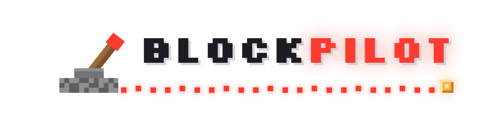
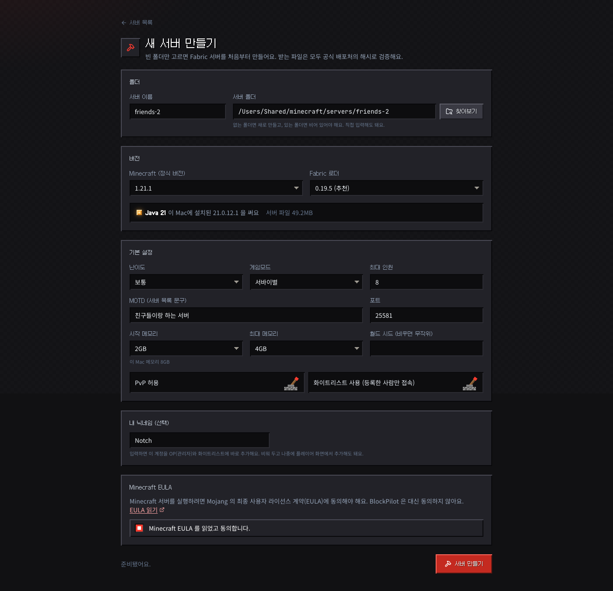
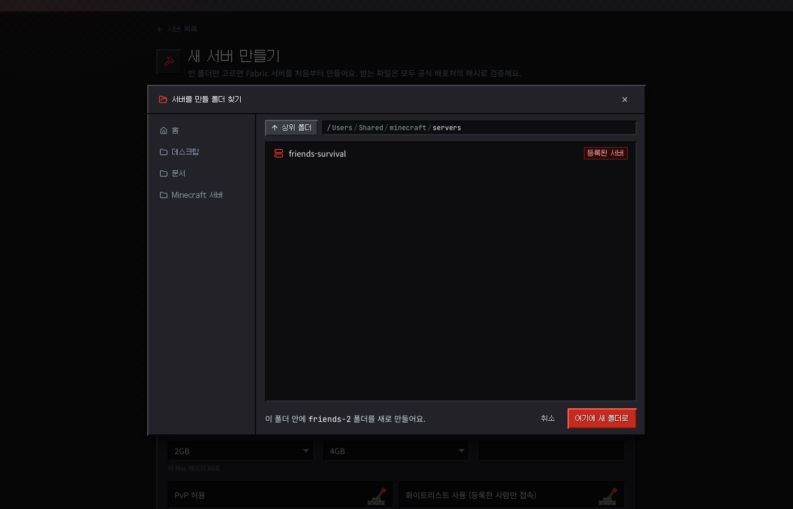
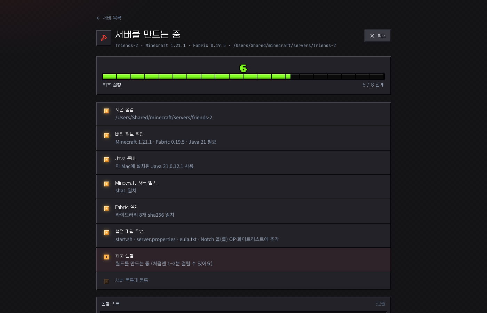
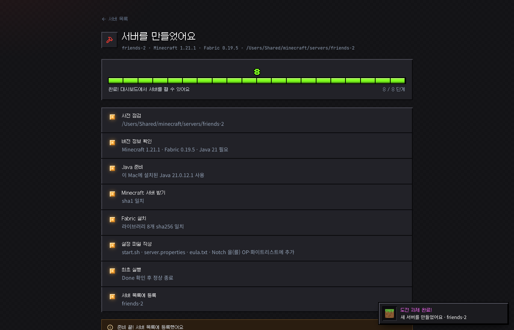

<p align="center">
  <picture>
    <source media="(prefers-color-scheme: dark)" srcset="docs/logo-dark.png">
    
  </picture>
</p>

<p align="center">
  마인크래프트 서버 폴더 경로 하나만 등록하면<br>
  설정 · 모드 · 플레이어 · 콘솔 · 로그 · 백업을 브라우저에서 관리하는 로컬 대시보드
</p>

<p align="center">
  
  
  
  
  
  
  <a href="https://github.com/sjc4197/BlockPilot/actions/workflows/ci.yml"></a>
</p>

<p align="center">
  
</p>

---

## 왜 만들었나

친구들과 서바이벌 서버를 돌리다 보면 `server.properties` 열어서 난이도 고치고, `whitelist.json`에 UUID 찾아 넣고, 모드 버전 충돌 로그 뒤지는 일이 반복됩니다. BlockPilot은 그 작업을 전부 GUI로 옮기되, **서버가 이미 하고 있는 일을 망치지 않는 것**을 최우선으로 설계했습니다.

- 서버가 **실행 중이면** 콘솔 명령(`difficulty`, `whitelist add` …)으로 즉시 반영하고, 명령으로 못 바꾸는 항목은 파일에 저장한 뒤 "재시작 필요"로 표시합니다. (마인크래프트는 종료 시 설정 파일을 다시 쓰기 때문에, 실행 중에 파일을 직접 고치면 덮어써집니다.)
- 서버가 **중지 상태면** 파일을 직접 수정합니다. 쓰기 전에 `.blockpilot-backup/`에 사본을 남기고 임시 파일 → rename으로 원자적으로 교체합니다.
- BlockPilot **밖에서 띄운 서버**도 RCON이 켜져 있으면 명령·중지·접속자 조회가 됩니다.

## 기능

| 화면 | 할 수 있는 것 |
|---|---|
| **새 서버 만들기** | 빈 폴더만 고르면 Fabric 서버를 처음부터 구축. 정식 버전·로더 선택, 필요한 Java 를 앱 폴더에 자동 준비, 모든 다운로드 해시 검증, 최초 실행까지 마치고 목록에 등록 |
| **대시보드** | 로더·버전·접속자·모드 수 요약, 시작 / 중지 / 재시작, 접속자 킥·밴, 최근 콘솔 |
| **서버 설정** | `server.properties`를 게임플레이 / 월드 / 플레이어 / 네트워크 / 성능 탭의 폼으로 편집. 그 외 키는 고급 탭에서 raw 편집. 주석과 키 순서 보존. 맨 아래 **서버 관리**에서 목록 등록 해제(파일 유지) 또는 **서버 삭제**(폴더째 영구 삭제) |
| **플레이어** | 화이트리스트 · OP · 밴(플레이어/IP). 닉네임만 입력하면 Mojang API로 UUID 자동 조회 |
| **모드** | jar 안의 `fabric.mod.json` / `mods.toml` / `plugin.yml`을 읽어 이름·버전·설명·의존성 표시, **의존성 누락 경고**, 활성/비활성 토글, 삭제, 업로드, 친구용 클라이언트 모드 zip 내보내기 |
| **설정 파일** | `config/`, `plugins/` 안의 toml · json · yaml · properties 편집기. 저장 전 문법 검사(오류 행 표시), `Cmd/Ctrl+S` 저장 |
| **콘솔** | WebSocket 실시간 스트리밍, 명령어 전송, ↑↓ 히스토리, WARN/ERROR 색상 |
| **로그** | `logs/`(gz 포함) · `crash-reports/` 보기, 검색, WARN/ERROR 필터, `latest.log` 자동 갱신 |
| **백업** | 월드 zip 백업 / 복원 / 다운로드, 간격·보관 개수 기반 자동 백업 (실행 중이면 `save-all flush` 후 백업) |

지원 로더: **Fabric · Forge · NeoForge · Paper/Purpur · Vanilla** (폴더 구조로 자동 감지)

### 마크 연출

- **전원 회로**: 레버를 당기면 레드스톤 신호가 대시보드 카드로 흘러가고, 켜져 있는 동안 서버 카드 뒤로 레드스톤 입자가 떠올라요
- **하트 접속자**: 접속자 수를 체력 하트로(한 칸 = 두 명), 입장·퇴장은 노란 채팅 줄로
- **발전 과제 알림**: 저장·백업·서버 만들기 완료 알림. 처음 하는 일은 보라색 도전 과제로 한 번
- **경험치 바**: 새 서버 만들기 진행률. 단계를 마칠 때마다 레벨이 올라요
- **핫바 메뉴**: 숫자 키 `1`~`8` 로 메뉴 이동, 선택한 메뉴에 핫바 칸 테두리
- **꾹 눌러 캐기 · TNT · 상자**: 삭제 버튼은 금이 가다 부서지고, 서버 삭제는 TNT 가 터지고, 백업은 상자에 월드 블록이 들어가요

컴퓨터의 "동작 줄이기" 설정을 켜면 움직임 없이 보여요.

### 지원 환경

| | macOS | Linux | Windows |
|---|---|---|---|
| 기존 서버 연결·관리 | ✅ | ✅ | ✅ |
| 새 서버 만들기 (Fabric) | ✅ Apple Silicon · Intel | ✅ x64 · ARM64 (Ubuntu·Debian·Fedora 등, Alpine) | ✅ Windows 10·11, x64 · ARM64 |
| 서버 시작 스크립트 | `start.sh` / `run.sh` | `start.sh` / `run.sh` | `start.bat` / `run.bat` (끝의 `pause` 처리) |

OS 는 고르지 않아요. BlockPilot 이 켜질 때 돌고 있는 컴퓨터를 자동으로 알아보고, 첫 화면 아래에 "이 컴퓨터: OS · CPU" 로 보여 줘요.
push 할 때마다 GitHub Actions 가 macOS·Ubuntu·Windows 에서 단위 테스트와 **실제 서버 만들기 → 켜기 → 끄기 → 삭제** 를 돌려요.

## 스크린샷

<table>
  <tr>
    <td align="center"><b>서버 설정</b><br></td>
    <td align="center"><b>모드 (의존성 표시)</b><br></td>
  </tr>
  <tr>
    <td align="center"><b>플레이어</b><br></td>
    <td align="center"><b>실시간 콘솔</b><br></td>
  </tr>
  <tr>
    <td align="center"><b>설정 파일 편집기</b><br></td>
    <td align="center"><b>로그 뷰어</b><br></td>
  </tr>
  <tr>
    <td align="center"><b>백업</b><br></td>
    <td align="center"><b>서버 선택</b><br></td>
  </tr>
</table>

## 시작하기

### 요구 사항

- **macOS · Linux · Windows** 중 하나
- **Node.js 20 이상** ([nodejs.org](https://nodejs.org) 에서 LTS 설치)
- 기존 서버를 연결할 때: 그 서버 폴더와 서버를 돌릴 Java
- 새 서버를 만들 때: 빈 폴더만 있으면 돼요. Java 가 없으면 BlockPilot 이 앱 폴더에 받아서 써요

### 설치 및 실행

```bash
git clone https://github.com/sjc4197/BlockPilot.git
cd BlockPilot
npm install
npm run build
npm start
```

브라우저에서 **http://127.0.0.1:4800** 을 엽니다.

- **Windows** — PowerShell 이나 명령 프롬프트에서 위 명령을 그대로 쓰면 돼요. 서버를 처음 켤 때 "Windows 보안 경고(방화벽)" 창이 뜨면 **액세스 허용**을 눌러야 친구들이 접속할 수 있어요.
- **Linux** — 방화벽(ufw)을 쓰면 서버 포트를 열어 주세요 (`sudo ufw allow 25565/tcp`). 화면 없는 원격 서버라면 아래 "외부에서 접속하기"를 참고하세요.

### 사용법

1. **서버 등록** — 첫 화면에서 서버 폴더의 절대 경로를 입력합니다. (예: `/Users/me/minecraft/survival`, `C:\Minecraft\survival`) BlockPilot이 마인크래프트 서버 폴더인지 확인하고 로더·버전을 감지합니다.
2. **시작** — 대시보드의 **레버를 당기면** 서버가 켜집니다. 폴더에 그 OS 의 시작 스크립트(`start.sh`·`run.sh` / Windows 는 `start.bat`·`run.bat`)가 있으면 **그 스크립트를 그대로 실행**하므로 메모리 옵션(`-Xmx` 등)은 스크립트에서 관리하면 됩니다. 스크립트가 없으면 감지된 서버 jar를 `java -Xms2G -Xmx4G -jar … nogui` 로 띄웁니다.
3. **설정 변경** — 서버 설정 탭에서 값을 바꾸고 하단 저장 바를 누릅니다. 실행 중이면 즉시 적용된 항목과 재시작이 필요한 항목을 알려줍니다.
4. **친구 초대** — 플레이어 탭에서 닉네임 입력 → 추가. 모드 서버라면 모드 탭의 **친구용 zip 다운로드**로 클라이언트에 넣을 모드를 한 번에 전달할 수 있습니다.
5. **중지** — 켜진 레버를 **두 번 당기면**(3초 안에 한 번 더) `stop` 명령을 보내 월드 저장을 기다린 뒤 종료합니다 (30초 무응답 시 시작 스크립트와 java 를 함께 강제 종료). BlockPilot 자체를 `Ctrl+C` 로 끄면 떠 있는 서버도 같은 방식으로 정리합니다.
6. **목록에서 빼기 · 서버 삭제** — 서버를 끈 뒤 **서버 설정** 탭 맨 아래 **서버 관리**로 갑니다.
   - **등록 해제**: BlockPilot 목록에서만 빼요. 서버 폴더와 월드는 그대로 남습니다. 서버 목록 화면의 "등록 해제"도 같아요.
   - **서버 삭제…**: 서버 폴더를 통째로 영구 삭제해요. 창에 서버 이름을 그대로 입력하고 **영구 삭제**를 누르면 TNT 가 터지며 지워집니다. 폴더 안 `backups/` 도 함께 지워지니 필요하면 먼저 백업 화면에서 다운로드해 두세요.

> **BlockPilot 밖에서 서버를 띄운 경우** — 대시보드에 "외부 실행 중"으로 표시됩니다. `server.properties` 에서 `enable-rcon=true`, `rcon.password=…` 를 설정하고 서버를 재시작하면 콘솔 명령·중지·접속자 조회가 RCON으로 동작합니다.

### 새 서버 만들기

첫 화면의 **새 서버 만들기** → 폴더를 고르고 버전·기본 설정을 정한 뒤 EULA 에 직접 동의하면, 나머지는 BlockPilot 이 해요.

<table>
  <tr>
    <td align="center"><b>입력</b><br></td>
    <td align="center"><b>폴더 찾기</b><br></td>
  </tr>
  <tr>
    <td align="center"><b>진행</b><br></td>
    <td align="center"><b>완료</b><br></td>
  </tr>
</table>

1. **사전 점검** — 폴더가 비었는지, 포트·메모리·디스크 여유, 닉네임이 실제로 있는지
2. **버전 확인** — Minecraft 정식 버전과 Fabric 로더 호환, 이 버전이 요구하는 Java (1.21.x → 21, 26.x → 25)
3. **Java 준비** — 이 컴퓨터에 정확히 그 버전 JDK 가 있으면 사용(macOS `java_home`, Linux `/usr/lib/jvm`·SDKMAN, Windows `JAVA_HOME`·Program Files, 그리고 PATH), 없으면 Temurin 을 앱 폴더(`~/.blockpilot/runtimes/`, Windows 는 `%USERPROFILE%\.blockpilot\runtimes\`)에 받아서 사용. 시스템에는 설치하지 않아요
4. **server.jar · Fabric 설치** — 공식 설치기로 설치하고 라이브러리까지 전부 해시 대조
5. **설정 파일** — `start.sh` 또는 Windows 는 `start.bat`(Java 경로·메모리 고정), `server.properties`, `eula.txt`, 닉네임을 OP·화이트리스트에 추가
6. **최초 실행** — 월드를 만들고 `Done` 이 뜨면 정상 종료
7. **등록** — 서버 목록에 추가하고 대시보드로

| 받는 파일 | 출처 | 검증 |
|---|---|---|
| 버전 정보 | Mojang `piston-meta` | 매니페스트의 sha1 |
| `server.jar` | Mojang | sha1 |
| Fabric 설치기 | `maven.fabricmc.net` | 같은 저장소의 sha256 |
| Fabric 라이브러리 | 설치기가 받음 | 설치 후 하나씩 sha256 대조 |
| JDK (Temurin) | Adoptium | sha256 |

- **EULA** 는 사용자가 체크박스를 직접 체크해야만 진행돼요. 체크하지 않으면 버튼이 눌리지 않고 API 도 거부해요.
- **실패하거나 취소하면** 원인과 해결 방법을 한글로 보여 주고, 이번에 만든 파일만 지워요. 원래 폴더에 있던 것은 건드리지 않아요. 도중에 BlockPilot 이 꺼져도 다음에 켤 때 같은 방식으로 정리해요.
- 해시 검증까지 끝난 JDK 는 다음에 다시 쓰도록 앱 폴더에 남겨요.

### 외부에서 접속하기 (선택)

기본값은 `127.0.0.1` 바인딩, 인증 없음입니다. 다른 기기에서 접속하려면:

```bash
BLOCKPILOT_HOST=0.0.0.0 npm start            # macOS · Linux
```

```powershell
$env:BLOCKPILOT_HOST="0.0.0.0"; npm start   # Windows PowerShell
```

외부 주소에 바인딩하면 접속 토큰이 자동 생성되어 터미널 로그에 출력되고, 대시보드가 토큰 입력 화면을 띄웁니다. 토큰을 직접 정하려면 `BLOCKPILOT_TOKEN=원하는값` 을 함께 넘기세요.

## 환경 변수

| 변수 | 기본값 | 설명 |
|---|---|---|
| `BLOCKPILOT_PORT` | `4800` | 대시보드 포트 |
| `BLOCKPILOT_HOST` | `127.0.0.1` | 바인딩 주소. 루프백이 아니면 토큰 인증이 자동으로 켜짐 |
| `BLOCKPILOT_TOKEN` | (없음) | 접속 토큰 지정. 설정하면 루프백에서도 토큰 필요 |
| `BLOCKPILOT_HOME` | `~/.blockpilot` | 앱 폴더: 등록된 서버 목록 · 자동 백업 설정 · 토큰 · 받아 둔 JDK(`runtimes/`) · 만들기 작업 일지(`jobs/`) |
| `LOG_LEVEL` | `info` | Fastify 로그 레벨 |

## 기술 스택

| 영역 | 사용 기술 | 비고 |
|---|---|---|
| 언어 | **TypeScript** (strict) | 프론트·백엔드·공유 타입 전부 |
| 백엔드 | **Fastify 5** | `@fastify/websocket` 콘솔 스트리밍, `@fastify/multipart` 모드 업로드, `@fastify/static` 빌드된 UI 서빙 |
| 프론트 | **React 18 + Vite 5 + Tailwind CSS 3** | 라우팅 `react-router-dom`, 서버 상태 `@tanstack/react-query` |
| 스키마/검증 | **zod** | API 입력 검증, 프론트·백엔드가 같은 타입 공유 (`packages/shared`) |
| 파일 처리 | `yauzl` / `yazl` | jar 메타데이터 읽기, 백업·모드 zip 생성 |
| 설정 파서 | `smol-toml`, `yaml` | 모드 설정 문법 검사. `server.properties`는 주석·순서 보존 자체 파서 |
| 프로세스 | Node `child_process` + 자체 **RCON** 클라이언트 | stdin/stdout 파이프 제어, 외부 서버는 Source RCON 프로토콜 |
| 테스트 | **vitest** | 파서(properties, 버전 범위, 설정 문법), 다운로드·해시 검증(로컬 HTTP 서버), 작업 정리·취소·재시작 복구 |
| 폰트 | [Galmuri11](https://github.com/quiple/galmuri) · Silkscreen (SIL OFL 1.1), IBM Plex Sans KR, JetBrains Mono | 제목·메뉴는 한글 픽셀 서체, 본문은 일반 서체, 콘솔은 고정폭 |
| 패키지 구조 | npm workspaces 모노레포 | `shared` · `server` · `web` |

## 구조

```
BlockPilot/
├── packages/
│   ├── shared/              zod 스키마, API 타입, server.properties 키 메타데이터(라벨·그룹·즉시 적용 명령)
│   ├── server/
│   │   └── src/
│   │       ├── routes/      servers · properties · players · mods · process(+WS 콘솔) · configs · logs · backups · auth
│   │       │                create(새 서버 만들기) · fs(폴더 찾기)
│   │       ├── services/    serverInfo(로더 감지) · properties(파서) · mods(jar 파싱·의존성)
│   │       │                process(spawn/stdin) · rcon · backups · scheduler · logs · configs · mojang
│   │       │                create/  sources(Mojang·Fabric·Adoptium) · download(해시 검증) · java · target(폴더 검증·정리)
│   │       │                         job(진행·일지·취소·복구) · pipeline(설치 단계)
│   │       └── lib/         safePath(경로 탈출 차단) · atomicWrite(백업+원자적 쓰기) · auth
│   └── web/
│       └── src/
│           ├── pages/       Dashboard · Settings · Players · Mods · ConfigFiles · Console · Logs · Backups · Login · NewServer
│           ├── components/  ProcessControls · Lever · FolderPicker
│           ├── api/         fetch 클라이언트, react-query 훅
│           └── lib/         UI 프리미티브, 픽셀 그림, 연출(fx·burst), WebSocket 콘솔 훅
└── docs/screenshots/
```

### 안전장치

- 브라우저 교차 출처 차단: CORS를 열지 않고, `/api/*`(WebSocket 포함)는 `Origin`이 대시보드 자신과 같을 때만 허용. `Host` 헤더도 검사해 DNS 리바인딩 방어
- 모든 파일 접근은 등록된 서버 폴더 하위인지 검증 (`../` 탈출 차단)
- 파일 쓰기 전 자동 백업 + 임시 파일 → rename
- 모드 변경 · 월드 복원은 서버가 중지된 상태에서만 허용
- 복원 시 기존 월드는 삭제하지 않고 `.blockpilot-backup/restore-<시각>/` 으로 이동
- 모드·플레이어·백업 삭제는 버튼을 꾹 누르고 있어야 실행, 서버 중지·재시작·복원은 두 번 눌러 확인
- 새 서버 만들기: 빈 폴더만 허용(시스템·홈·앱 폴더, 등록된 서버와 겹치는 폴더 거부), 받는 파일 전부 해시 검증, 실패 시 시작 시점에 없던 항목만 삭제, EULA 자동 동의 없음
- 서버 삭제: 서버 이름을 그대로 입력해야 하고(API 도 확인), 서버가 꺼져 있을 때만 가능. 심볼릭 링크는 실제 폴더를 따라가 확인하고, 시스템·홈·앱 폴더나 더 이상 서버 폴더가 아닌 곳, 다른 등록된 서버를 품은 폴더는 거부

## 개발

```bash
npm run dev          # 백엔드 4800 (tsx watch) + 프론트 4801 (Vite HMR, /api 프록시)
npm test             # vitest
npm run typecheck    # 세 패키지 tsc --noEmit
```

## 로드맵

- [x] 새 서버 만들기 — Fabric (macOS · Linux · Windows)
- [ ] 새 서버 만들기 — Paper · Forge · NeoForge
- [x] Linux 지원
- [x] Windows 지원 ([실제 PC 점검 체크리스트](docs/windows-checklist.md))
- [ ] Node 설치 없이 실행되는 설치 파일, Linux 부팅 시 자동 실행(systemd)
- [ ] Modrinth API 연동 모드 검색·설치
- [ ] 플레이어 통계 (`stats/`, `playerdata/` 파싱)

## 라이선스

MIT
